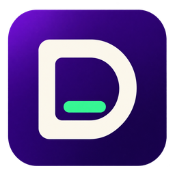

# Deskmate

Dynamic island dan dock untuk Windows. Lihat musik, notifikasi, jadwal, dan tugas dari desktop.

[**Unduh Deskmate.exe**](https://github.com/movlution/deskmate/releases/latest/download/Deskmate.exe) · [Catatan rilis](https://github.com/movlution/deskmate/releases/latest)

Jalankan EXE, lalu arahkan kursor ke island di tepi atas layar. Mendukung Windows 10 versi 2004 ke atas dan Windows 11 (64-bit).

## Fitur utama

- **Island dan dock** untuk musik dan lirik, notifikasi, kontrol cepat, dan akses aplikasi.
- **Ruang kerja** untuk kalender, papan tugas, catatan, dan riwayat clipboard.
- **Asisten AI** untuk bertanya, mendikte teks, dan merangkum rapat.

## Panduan

- [Fitur dan cara pakai](docs/fitur.md) · [Pengaturan](docs/pengaturan.md) · [Integrasi](docs/integrasi.md)
- [Sambungkan Tepi Android](docs/hp.md) · [Privasi dan keamanan](docs/privasi-keamanan.md)

## Build sendiri

Butuh Windows 10/11 64-bit dan .NET Framework 4.8. Jalankan `build.cmd` untuk menghasilkan `Deskmate.exe`.

## Struktur

- `src/` — kode aplikasi WinForms/WPF interop dengan UI owner-drawn.
- `tests/` — harness E2E PowerShell, suite tier 1–2, dan pemeriksaan ad-hoc.
- `docs/` — panduan fitur, pengaturan, integrasi, dan privasi.
- `build.cmd` — kompilasi dengan `csc` bawaan Windows.
- `TEST_INFRA.md` — spesifikasi harness pengujian.

Inti island dipecah menjadi beberapa partial class:

- `src/Island.cs` — field, konstruktor, lifecycle window, dan pemilihan monitor.
- `src/IslandMotion.cs` — spring, ukuran canvas, frame scheduler, dan animasi.
- `src/IslandRender.cs` — render shell, snapshot, bayangan, bubble, dan konten view.
- `src/IslandInput.cs` — hit-testing, hover, pointer, mouse, dan hotkey.
- `src/IslandSystem.cs` — toast, notifikasi sistem, daya baterai, tray, dan timer.

Jendela Catatan/Tugas juga dipecah berdasarkan tanggung jawab:

- `src/WorkWindow.cs` — konstruktor, layout, tab, dan state bersama.
- `src/WorkWindowTasks.cs` — rel tugas, papan, sinkronisasi, dan aksi tugas.
- `src/WorkWindowNotes.cs` — daftar catatan, editor Markdown, filter, pin, dan aksi catatan.

Editor gambar dipecah menjadi:

- `src/Redact.cs` — entry point `OpenRedact` dan enum `ToolMode`.
- `src/RedactToolStrip.cs` — tool strip GDI+ dan aksesibilitas.
- `src/RedactWindow.cs` — core jendela, layout, paint, kanvas, dan zoom.
- `src/RedactWindowInput.cs` — mouse, hit test, dan helper geometri editor redaksi.
- `src/RedactWindowCrop.cs` — handler crop dan penerapan hasil crop.
- `src/RedactWindowSelect.cs` — handler seleksi, resize, dan hit test anotasi.
- `src/RedactWindowText.cs` — editor teks inline, hapus, dan shortcut keyboard.
- `src/RedactWindowModel.cs` — geometri, undo/redo/reset, apply, dan export.

Fitur combo ketikan dipecah menjadi:

- `src/Combo.cs` — state, setelan, statistik, XP, quest, sprint, dan toggle.
- `src/ComboInput.cs` — hook keyboard, registrasi tombol, dan pemutusan combo.
- `src/ComboFx.cs` — partikel, tier, animasi, dan render combo.

Audio combo dipecah menjadi:

- `src/ComboAudio.cs` — voice state, startup, dan lifecycle mixer.
- `src/ComboAudioBackend.cs` — resampling, WASAPI, fallback waveOut, dan loop mixer.
- `src/ComboSynth.cs` — efek suara dan sintesis waveform.

Jadwal kelas dan dialog kalender dipecah menjadi:

- `src/Schedule.cs` — model jadwal, tab, pengingat, dan aksi event Google Calendar.
- `src/ScheduleDialog.cs` — field, konstruktor, aksi, dan layout `GoogleEventDialog`.
- `src/ScheduleDialogFields.cs` — `RoundedField` dan `EventPillButton`.
- `src/ScheduleDialogPickers.cs` — popup kalender dan pemilih waktu.

Sumber Google Calendar dipecah menjadi:

- `src/GoogleCal.cs` — vault OAuth dan alur login loopback.
- `src/GoogleCalendarSource.cs` — fetch, pull, pembuatan, update, dan hapus event.
- `src/GoogleCalParse.cs` — refresh token, parsing event, dan tautan meeting.

Tab Kontrol dipecah menjadi:

- `src/Control.cs` — lifecycle, state, layout halaman, mode perangkat, dan header/notice bersama.
- `src/ControlWifi.cs` — tampilan inline Wi-Fi, pemindaian, join, dan disconnect.
- `src/ControlBluetooth.cs` — pemindaian, aksi, dan menu perangkat Bluetooth.
- `src/ControlWidgets.cs` — slider, chip/daftar perangkat, toggle, timer, switch, dan HUD.
- `src/ControlWifiPass.cs` — dialog password Wi-Fi (`WifiPassBox`).

Chat Suruh Deskmate dipecah menjadi:

- `src/SuruhChat.cs` — model pesan, penyimpanan riwayat, dan logika percakapan.
- `src/SuruhChatInput.cs` — kotak input multiline (`ChatInput`).
- `src/SuruhChatWell.cs` — bingkai input (`ChatWell`).
- `src/SuruhChatWindow.cs` — jendela chat, header, dan pengiriman pesan.
- `src/SuruhChatList.cs` — daftar pesan, chip aksi, typing indicator, dan scroll.

Mesin konversi file dipecah menjadi:

- `src/Converter.cs` — registry format, target, orkestrasi job, nama file, dan helper WinRT.
- `src/ConverterImage.cs` — gambar, PDF, dan arsip.
- `src/ConverterTools.cs` — ffmpeg, LibreOffice, pandoc, proses, dan merge PDF.
- `src/ConverterCompress.cs` — kompres, PDF ke Word, OCR, dan Word COM.

Parser iCalendar dipecah menjadi:

- `src/Ics.cs` — tipe hasil, `Parse`, pembaca komponen, dan helper baris/properti.
- `src/IcsModel.cs` — konteks feed, zona waktu, dan model aturan rekurensi.
- `src/IcsRecurrence.cs` — perhitungan rekurensi, event, dan to-do.

Pembaca/penulis PDF dipecah menjadi:

- `src/PdfLite.cs` — tipe nilai PDF (`PdfName`, `PdfRef`, `PdfRaw`, `PdfDict`, `PdfStream`).
- `src/PdfFile.cs` — xref, objek, halaman, dan filter.
- `src/PdfLexer.cs` — lexer token PDF.
- `src/PdfLiteWriter.cs` — rewrite, kompres, merge, dan writer objek/xref.

Pengingat dipecah menjadi:

- `src/Reminders.cs` — UI dan logika pengingat di `Island`.
- `src/PrayTimes.cs` — perhitungan waktu sholat.
- `src/PrayCities.cs` — preset kota, pencarian, dan penyimpanan lokasi.

Render dock dipecah menjadi:

- `src/DockPaint.cs` — render utama, bar, glass, icon, dan cache ikon.
- `src/DockPaintSpan.cs` — span kapsul samping, cache, indikator, dan badge.
- `src/DockPaintFlyer.cs` — animasi flyer dan shatter.
- `src/DockPaintChrome.cs` — label atas, tray, status, jam, dan shell.
- `src/DockPaintLeft.cs` — widget kiri, ghost, media, AI, dan meter.

Input dock dipecah menjadi:

- `src/DockInput.cs` — field, hover, mouse, buka app, dan card.
- `src/DockInputKeys.cs` — hold open, StartKey, dan navigasi keyboard.
- `src/DockInputMenu.cs` — menu cepat, menu Start, posisi bar, dan reorder.
- `src/DockInputTray.cs` — tray, drag/drop file, dan pin.

Kuota agen dipecah menjadi:

- `src/Quota.cs` — tampilan kuota di `Island`, peringatan, dan teks.
- `src/QuotaStatusLine.cs` — status line, parsing input, dan rantai perintah.
- `src/QuotaJson.cs` — pembaca/penulis JSON ringan.
- `src/QuotaSetup.cs` — pemasangan dan penghapusan status line Claude/Antigravity.
- `src/QuotaLogs.cs` — pembacaan kuota dari log Codex dan Copilot.
- `src/QuotaModel.cs` — model `QuotaWindow` dan `QuotaInfo`.

Teleprompter dipecah menjadi:

- `src/Prompter.cs` — state, scroll, pengukuran kata, render, dan resize di `Island`.
- `src/PrompterSetup.cs` — dialog pengaturan script, kecepatan, ukuran, dan perpustakaan.
- `src/PrompterControls.cs` — `ScriptWell` dan `KeyList`.

Kontrol dialog Kit dipecah menjadi:

- `src/Kit.cs` — warna `KitInk`, `KitText`, `KitControl`, `KitSwitch`, dan `KitSegmented`.
- `src/KitPickers.cs` — `KitPalette` dan `KitSlider`.
- `src/KitButtons.cs` — `KitButton`, `KitCheck`, `KitPopup`, `KitGroup`, dan `KitRow`.
- `src/KitWindow.cs` — `KitWindow` dan `KitAsk`.

Composer prompt agen dipecah menjadi:

- `src/AgentPrompt.cs` — input keyboard, helper prompt, dan pengiriman ke terminal.
- `src/AgentPromptBox.cs` — jendela composer dan riwayat prompt.
- `src/AgentPromptHeader.cs` — header proyek, status, plan, dan kuota.
- `src/AgentPromptUi.cs` — placeholder edit, key hints, dan daftar prompt.

Siklus hidup feed dipecah menjadi:

- `src/Life.cs` — state feed, update check, media, dan lirik.
- `src/LifeNotify.cs` — volume, jaringan, privasi, dan notifikasi.
- `src/LifeAgents.cs` — agen, phone listener, hub, hook, dan sesi.
- `src/LifeApprovals.cs` — detail approval, keputusan, dan ringkasan sesi.
- `src/LifeKulia.cs` — tugas Kulia, deadline, dan tautan.

Bluetooth dipecah menjadi:

- `src/Bluetooth.cs` — baterai perangkat dan hook Bluetooth di `Island`.
- `src/BluetoothScanner.cs` — model perangkat, watcher, pemindaian, pairing, dan koneksi.

Pengaturan dipecah menjadi:

- `src/Prefs.cs` — aksi preferensi di `Island`, tema, flag, pilihan, dan pratinjau layout.
- `src/PrefsWindow.cs` — state, konstruktor, layout, page builder, dan `PageHeader`.
- `src/PrefsPages.cs` — isi halaman pengaturan per kategori.
- `src/PrefsLayout.cs` — baris update, tab, `TabGrip`, urutan kartu, dan kontrol tampilan.
- `src/PrefsSideList.cs` — sidebar kategori dan aksesibilitasnya.
- `src/PrefsThemePicker.cs` — pemilih kartu tema.
- `src/PrefsCitySuggest.cs` — saran nama kota.

Terjemahan dipecah menjadi:

- `src/Lang.cs` — flag bahasa, pembangunan kamus, `T`, dan `F`.
- `src/LangCore.cs` — teks UI inti.
- `src/LangIntegrations.cs` — teks integrasi.
- `src/Lang20.cs` — teks fitur 2.0.
- `src/LangCardsAndPlacement.cs` — kartu ringkasan, letak, riwayat Bicara, dan prioritas notifikasi.
- `src/LangDockAndSettings.cs` — dock dan judul bagian pengaturan.
- `src/LangPictureAndReadability.cs` — editor gambar, keterbacaan, izin, dan rekaman.
- `src/LangCombo.cs` — combo ketikan.
- `src/LangWhatsNew.cs` — catatan rilis 2.7.x.

Sumber data dipecah menjadi:

- `src/Sources.cs` — model fetch, hasil sumber, dan `Source`.
- `src/SourceHoliday.cs` — sumber hari libur nasional.
- `src/SourceHub.cs` — sinkronisasi dan penggabungan sumber.
- `src/SourceIcsFeed.cs` — sumber feed iCalendar.
- `src/SourcesIsland.cs` — penggabungan sumber ke daftar UI `Island`.

Google Workspace dipecah menjadi:

- `src/GoogleWorkspace.cs` — helper HTTP dan klien Google Tasks.
- `src/GoogleTasksSource.cs` — adaptor sumber tugas Google Tasks.
- `src/GoogleDriveNotes.cs` — klien catatan Markdown di Google Drive.

Token visual dan painter dipecah menjadi:

- `src/Ink.cs` — `Tone` dan token desain `Ink`.
- `src/Springs.cs` — preset spring.
- `src/Painter.cs` — helper paint GDI+.

Sisanya adalah partial `Island` per fitur (`Dock*`, `Prefs*`, `Work*`, `Notes*`, dan seterusnya).

## Tes

```powershell
.\build.cmd
powershell -NoProfile -ExecutionPolicy Bypass -File .\tests\run_e2e.ps1 -TestFile .\tests\smoke_test.ps1
```

Suite tier 1–2 dijalankan dengan `.\tests\run_e2e.ps1 -Tier 1` atau `-Tier 2`. Beberapa suite membuka jendela dan berinteraksi dengan desktop, jadi jalankan di sesi desktop. Tier 3–4 masih berupa placeholder.

Lisensi [MIT](LICENSE). Dibuat oleh [R. Revaldo Vabiansyah](https://github.com/odlaver).
